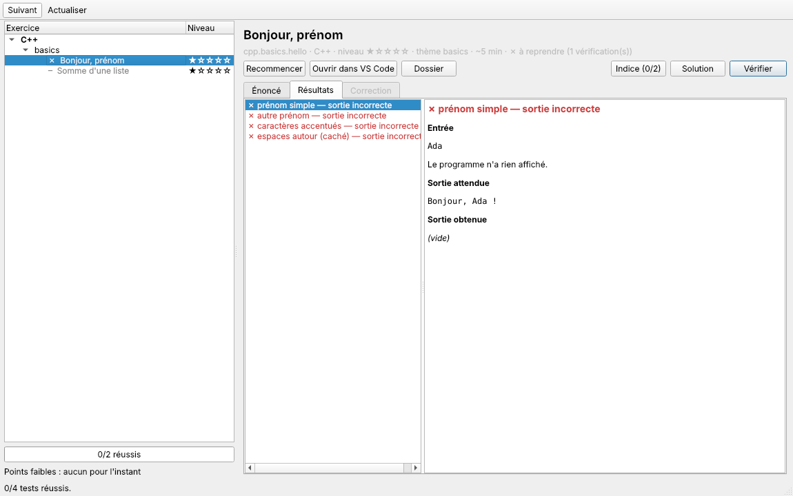

# trainer

Outil d'entraînement en ligne de commande pour apprendre **C++**, **Git**, **C#** et
**Rust** par la pratique. Il donne des exercices courts et des mini-projets, avec une
correction automatique et des explications.

Le moteur est écrit en C11 (POSIX). Il compile et exécute votre code avec les vrais
outils (`g++`, `git`, `dotnet`, `cargo`), puis compare la sortie aux tests.

> État : **étape 5a**. Des **cours** (pensés pour qui connaît le C) suivis d'exercices
> corrigés automatiquement, en ligne de commande ou dans une application graphique.
> Contenu actuel : 6 chapitres C++ (premier programme, références, fonctions, vector/array,
> classes, RAII), 17 exercices. À venir : 8 autres chapitres C++, puis Git, C# et Rust.



## Installation

Plateformes : Linux, macOS, Windows via WSL.

```sh
# Arch Linux
sudo pacman -S --needed base-devel gcc git valgrind gdb clang
# Debian / Ubuntu
sudo apt install build-essential g++ git valgrind gdb clangd

git clone <url-du-dépôt> trainer && cd trainer
make                 # produit ./trainer
make test            # vérifie que tout fonctionne sur votre machine
```

Installation globale (facultative) :

```sh
make install PREFIX=$HOME/.local    # ~/.local/bin doit être dans votre PATH
```

## Application graphique

```sh
sudo pacman -S --needed qt6-base cmake      # Debian/Ubuntu : qt6-base-dev cmake libgl-dev
make && make gui                            # produit ./trainer et ./trainer-gui
./trainer-gui
```

- **À gauche** : le catalogue avec l'état de chaque exercice, la progression et les
  points faibles.
- **À droite** : l'énoncé, les résultats test par test (entrée, différence, erreurs) et la
  correction.
- **Raccourcis** : « Suivant » (Ctrl+N) choisit l'exercice recommandé ; « Vérifier »
  (Ctrl+Entrée) compile et teste.
- Le code s'écrit dans VS Code (bouton « Ouvrir dans VS Code »). Une vérification lancée
  depuis VS Code (Ctrl+Maj+B) ou depuis le terminal met la fenêtre à jour automatiquement.

Installation dans le menu des applications : `make install install-gui PREFIX=$HOME/.local`.

## Utilisation en ligne de commande

```sh
trainer next                       # que faire maintenant ?
trainer learn                      # liste des cours
trainer learn cpp.lesson.basics    # lire un cours
trainer list                       # catalogue et état de chaque exercice
trainer show cpp.basics.hello      # énoncé
trainer start cpp.basics.hello     # copie le code de départ dans ~/trainer-workspace
trainer start cpp.basics.hello --open   # ... et l'ouvre dans VS Code
trainer check cpp.basics.hello     # compile, teste, explique
trainer hint cpp.basics.hello      # indice suivant
trainer solution cpp.basics.hello  # solution commentée (notée dans la progression)
trainer stats                      # progression et points faibles par thème
trainer doctor                     # outils installés et dossiers utilisés
```

La progression est enregistrée dans `~/.local/share/trainer/progress.txt` (ou
`$XDG_DATA_HOME/trainer/`). C'est un fichier texte lisible : une ligne par exercice.

Votre code se trouve dans `~/trainer-workspace/<langage>/<id>/`. Vous pouvez changer
cet emplacement avec `--workspace DIR` ou la variable `TRAINER_WORKSPACE`. Astuce :
faites de ce dossier un dépôt Git et commitez vos solutions, c'est un bon entraînement.

Codes de sortie : `0` réussite, `1` échec de l'exercice, `2` erreur d'utilisation.

### Avec VS Code

`trainer start` génère dans le dossier de l'exercice :

- `.vscode/tasks.json` : **Ctrl+Maj+B** lance `trainer check`, et les erreurs du
  compilateur deviennent cliquables (onglet « Problèmes ») ;
- `compile_flags.txt` : l'extension **clangd** utilise alors les mêmes options que le
  correcteur.

Ouvrez le **dossier de l'exercice** (pas tout le workspace), par exemple avec
`trainer start <id> --open`.

## Développement

Le moteur est une bibliothèque (`libtrainer.a`, dossiers `src/core` et `src/util`, en-tête
`include/trainer.h`) sans aucun affichage. Le programme `trainer` (`src/cli`, en C) et
l'application `trainer-gui` (`gui/`, en C++ avec Qt 6) n'en sont que deux interfaces.

```sh
make test        # tests unitaires + bout en bout + en-têtes compilables en C++20
./trainer validate   # chaque solution de référence passe ses tests, chaque starter échoue
make asan        # mêmes tests, moteur compilé avec AddressSanitizer + UBSan
make valgrind    # tests sous valgrind (aucune fuite tolérée)
make CC=clang    # vérifier avec un second compilateur
make gui-test    # application graphique : parcours d'élève simulé avec QTest
```

La CI GitHub (`.github/workflows/ci.yml`) lance tout cela à chaque push et pull request,
avec gcc et clang.

- Architecture et signatures : [docs/architecture.md](docs/architecture.md)
- Écrire un cours ou un exercice : [docs/exercise-format.md](docs/exercise-format.md)
